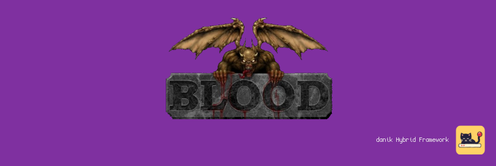
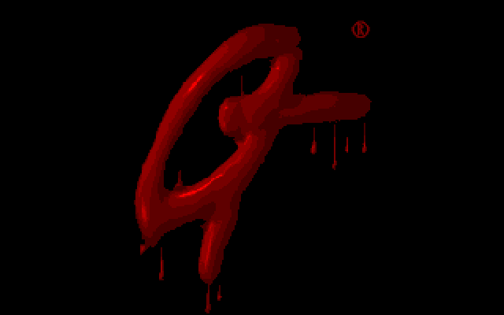
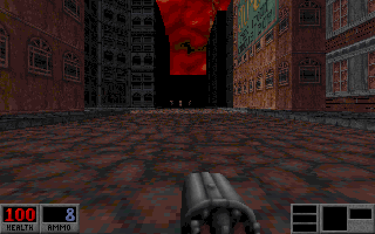

# NBlood for MiSTer

Blood, Cryptic Passage, Redneck Rampage, Redneck Rampage: Rides Again and PowerSlave on [MiSTer FPGA](https://github.com/MiSTer-devel/Main_MiSTer/wiki) as a hybrid port.

The games run on [NBlood](https://github.com/NBlood/NBlood), the source ports of Blood (1997), Redneck Rampage (1997) and PowerSlave (1996, known as Exhumed) by Nuke.YKT and its contributors, on EDuke32's Build engine, with the engine's classic software renderer. They run on the MiSTer's ARM CPU. The NBlood FPGA core provides native 15kHz video (CRT, VGA and HDMI) at 320x200, 640x200, 320x240 or 640x240, 44.1kHz audio, a MIDI synthesizer and an FM chip for Blood's music, and keyboard, mouse and gamepad input with rumble. The two halves talk through shared DDR3 memory.

> **Beta.** Expect rough edges and please report problems in the issues.
>
> **Disclaimer:** AI is being extensively used to speed up development, but the project is well-maintained and supported.

  
  

## Requirements

- **danik_hybrid_ports**, the launcher: run it **once** from the MiSTer's `Scripts` menu ([The launcher](#the-launcher)). Without it the core says "Game not running".
- **Game data**, which is not included: your own full games. Blood **version 1.21** (the GOG and Steam releases have it) with, optionally, Cryptic Passage; Redneck Rampage and Rides Again in the versions NBlood knows, the files of the exact sizes in the table below; PowerSlave or Exhumed for DOS, or its demo.
- **Recommended:** a gamepad with two analog sticks and analog triggers, like an Xbox or PlayStation controller. A gamepad without them works but is not recommended. The game can also be played with a keyboard and mouse.

## Installation

With `update_all` (Downloader 2.4 or newer, which update_all keeps up to date):

1. Copy [`downloader_danik_hybrid_ports.ini`](https://raw.githubusercontent.com/ItsDanik/Hybrid_MiSTer/main/launcher/downloader_danik_hybrid_ports.ini) to the root of your SD card (`/media/fat`).
2. Run `update_all`. That installs the launcher, **danik_hybrid_ports**, in `Scripts`.
3. Run **danik_hybrid_ports** from the `Scripts` menu, tick the games you want and press *X: Apply*. They are installed, and update_all keeps them up to date.
4. Copy **everything** in each game's folder, with its folders as they are and leaving nothing out, into a folder of its own in `/media/fat/games/dnk/NBloodD/`. Each game is known by its files:

   | Game | Goes in | Known by |
   |---|---|---|
   | Blood | `Blood/` | `BLOOD.RFF`, `GUI.RFF`, `SOUNDS.RFF`, `SURFACE.DAT`, `TILES0*.ART`, `VOXEL.DAT` |
   | Blood: Cryptic Passage | `Blood/`, with Blood | also `CRYPTIC.INI` and `CP0*.MAP` |
   | Redneck Rampage | `Redneck/` | `REDNECK.GRP` of 141,174,222 bytes |
   | Redneck Rampage: Rides Again | `Redneck/` | its GRP of 191,798,609 bytes, whatever its name: it is `REDNECK.GRP` too in some copies, so rename it `RA.GRP` to keep both games |
   | PowerSlave (Exhumed) | `PowerSlave/` | `STUFF.DAT` |
5. Load the game from the `Other` menu, e.g. **dnk-Blood**, or from the `Hybrid Ports` folder if you moved the games there in the launcher.

> [!NOTE]
> The game data can go on a USB drive instead, into the same folder there (`/media/usb0/games/dnk/NBloodD/`): the game looks for it there first, and then keeps its settings and saved games there as well. Everything else stays on the SD card.

Each game has its own menu entry, OSD settings and button mappings. A menu entry whose game has no data says on the core's screen which files are missing and where they go; the core loaded by itself lists the games whose data is there. Cryptic Passage's DOS installer writes its own art over Blood's `TILES007.ART` and `TILES015.ART`, and Blood then shows Cryptic Passage's title screen: keep Blood's two, and Cryptic Passage's as `CPART07.AR_` and `CPART15.AR_`, as the GOG and Steam releases have them.

The log is in `/media/fat/logs/dnk/NBloodD/nblood.log`. Settings and saved games are next to each game's data: in `Blood/`, `Redneck/RR/`, `Redneck/RRRA/` and `PowerSlave/`.

## The launcher

**danik_hybrid_ports** is what turns a menu entry into a running game. Once you've run it from the `Scripts` menu, it starts with the MiSTer, watches which core is loaded, and starts the game whenever a hybrid port's menu entry is loaded. It serves all our hybrid ports at once and updates itself through `update_all`.

Run it from the `Scripts` menu again whenever you want to change something. Its screen has:

- **Launcher**: on or off. Off, the ports' games no longer start (the core says "Game not running"), until you turn it on again.
- **Menu entries**: where the games appear in the MiSTer menu:
  - **Other, as dnk-\<Title\>**: each game in the `Other` menu, e.g. **dnk-Doom** (the default).
  - **Other/Hybrid Ports**: all of them in a *Hybrid Ports* folder in `Other`, without the `dnk-` in front.
  - **Main menu/Hybrid Ports**: a *Hybrid Ports* folder of its own in the main menu, next to `Arcade`, `Console` and `Other`.

  Moving them keeps each game's settings and button mappings. Favourites, recent lists and Zaparoo tags that point at the old place have to be made again.
- **The ports and their games**, a tickbox each. Tick what you want, untick what you don't.

*X: Apply* installs what is ticked and removes what is not, through Downloader, and moves the menu entries if you chose another place. When a port is removed, your game data, saved games and settings stay, and ticking it again brings it back as it was.

## OSD options

| Option | |
|---|---|
| Aspect ratio, Scale, Scandoubler Fx, Stereo Mix | as in other cores |
| FPS Counter | shows the pictures per second in the top left corner |
| HDMI Only | **Yes** if no CRT is connected: resolutions of 640x400 and more are then progressive instead of interlaced, and so is the core's own screen before the game, which moves at 60 pictures a second for a CRT and shows fine lines on HDMI without it. The analog output is switched off while one is shown, so that a 15kHz screen can never get such a signal. NBlood has no such resolution, so nothing changes in the game. Not needed with `forced_scandoubler=1` (VGA monitor); not there with `direct_video=1` |
| CRT Options | **Horizontal Size**: the picture's width **Horizontal Pos**: moves it left or right **Vertical Pos**: moves it up or down **HUD (Top)**: moves the game's messages 0 to 24 lines off the top edge (default 0), at 240 lines **HUD (Bottom)**: lifts the status bar and the weapon 0 to 24 lines off the bottom edge (default 0), at 240 lines  For a 15kHz screen: fits the picture to it and keeps the HUD out of the overscan. HDMI is not affected; not there with `forced_scandoubler=1` |
| Resolution | **320x200**: as the originals (default) **640x200**: twice the detail across, same picture size **320x240**: the view fills the whole screen **640x240**: both  Always at 15kHz. With 240 lines the HUD is drawn over the view at the *HUD* margins; menus and pictures stay at 200 lines, centred. Applies at once |
| L. Stick Sensitivity, R. Stick Sensitivity | how fast the left stick (walk, strafe) and the right stick (turn, look) move the player, 25% to 300%. They apply at once, on top of the sensitivity in the game's own menu |
| Limit Vertical Look | **On**: part of the game's range up and down (default) **Off**: the whole range  The Build engine shifts the picture instead of turning the camera, which distorts it the further you look up or down |
| Rumble | **On**: as the game has it (default) **Strong**: twice as strong **Off**: none  Blood and Redneck Rampage; PowerSlave has no rumble |
| Music | **MIDI**: the core's synthesizer, or an MT32-pi when one is connected and on (default) **FM chip**: as an AdLib or Sound Blaster card played it  Blood and Cryptic Passage. *SoundFont*: **Default** is GeneralUser GS, which comes with the port; 1 to 7 are your own `.sf2` files in `games/dnk/SoundFonts/`. A SoundFont that is missing, damaged or too big is said in the MiSTer's info box, and the music goes to the FM chip. Applies at once |
| MT32-pi | only there while an MT32-pi answers on the user port: see [NOTES.md](NOTES.md#music) |
| Cheats | **God Mode**: nothing hurts you **No Clipping**: walk through walls (Blood, Redneck Rampage) **Slip Mode**: the same (PowerSlave) **Show Full Map**: the whole level on the map **No Monsters**: the monsters are gone (Redneck Rampage) **Give Everything**: weapons, ammo and items (Blood, Redneck Rampage) **Give Items**: the items (PowerSlave) **Give Weapons**: every weapon **Give Keys**: all keys **Next Level**: completes the level (Blood, Redneck Rampage)  As the games' own cheats. Redneck Rampage refuses them at its hardest skill and on the levels of Rides Again that say so |
| Reset | starts the game again from its beginning, as the USER button does |
| Save Diagnostic Report | the last line: see [If something is wrong](#if-something-is-wrong) |

## Controls

- **Keyboard and mouse:**

| Key | Action |
|---|---|
| W, S | Walk forward, back |
| A, D | Sidestep left, right |
| Mouse (or left, right) | Turn. Moving the mouse up and down looks up and down |
| Left mouse button (or right Ctrl) | Fire |
| X | Alternate fire (Blood) |
| E | Open, use |
| Space | Jump |
| Left Ctrl | Crouch |
| Shift | Run (Caps Lock: always run) |
| 1 - 0 | Weapons (PowerSlave 1 - 7) |
| `'`, `;` | Next, previous weapon |
| Q | Quick kick (Redneck Rampage) |
| Enter, `[`, `]` | Use the inventory item, previous and next item |
| Page Up, Page Down | Look up and down |
| Tab | Map |
| F6, F9 | Quick save, quick load (Blood, Redneck Rampage) |
| Esc | Menu |

- **Gamepad** (default mapping):

| Button | Action |
|---|---|
| Left stick | Walk and strafe |
| Right stick | Turn, look up and down |
| D-pad | Walk and turn |
| R (RB / R1), or R2 | Fire |
| B (Xbox A / PlayStation Cross) | Open, use |
| A (Xbox B / PlayStation Circle) | Jump |
| L (LB / L1) | Crouch |
| Y (Xbox X / PlayStation Square) | Next weapon |
| X (Xbox Y / PlayStation Triangle) | Use the inventory item. Held, with the d-pad left or right: the previous or next item |
| L2 | Blood: alternate fire. Redneck Rampage: quick kick |
| L3 (left stick click) | Run, on and off |
| R3 (right stick click) | Blood: turn around. Redneck Rampage: quick kick. PowerSlave: look straight ahead |
| Select | Map |
| Start | Menu |

Change the buttons in the OSD under *Define NBloodD buttons*. *Menu OK* and *Menu Back* there are only needed for a spare button without a game function. While the OSD is open, the game gets no input.

> [!WARNING]
> A button left without a name in *Define NBloodD buttons* does not reach the game at all, except L2/R2, L3/R3 and *Menu OK* / *Menu Back*. Name every button there, or leave the definition as it is. To go back to the default buttons, delete `config/inputs/NBloodD_*_input_*_v3.map` (each game has its own) on the SD card.

Naming a game in PowerSlave without a keyboard: a new game asks for a name, and Menu OK without typing one names it `GAME <n>`.

## If something is wrong

If the game stutters, the sound breaks up or something else is wrong, open the OSD while it happens and pick **Save Diagnostic Report**, the last line of the menu. The game keeps running; MiSTer's info box says the report is saved in `games/dnk/diagnostics/` on the SD card. Send that file (`NBloodD_<date>_<time>.zip`) with a few words on what went wrong.

The report has the setup (versions, the video and audio lines of `MiSTer.ini`, the OSD settings), how the last 60 seconds went, the game's log and a screenshot. Nothing else: no network settings, addresses, saved games or lists of your files.

## Building

How the port works, how to build it and notes for development: [NOTES.md](NOTES.md).

## Support

If you enjoy this project, you can support my work on [Patreon](https://www.patreon.com/itsdanik).

## Credits

- **[NBlood](https://github.com/NBlood/NBlood)** by Nuke.YKT and the NBlood contributors: NBlood, Rednukem and PCExhumed, on the engine of [EDuke32](https://www.eduke32.com) by Richard "TerminX" Gobeille, Evan "Hendricks266" Ramos and its contributors.
- **Build engine** by Ken Silverman.
- **Apogee Sound System** by James R. Dose, in the engine's audio library.
- **[JTOPL](https://github.com/jotego/jtopl)** by Jose Tejada (jotego): the FM chip in the core.
- **[SDL](https://libsdl.org)** by Sam Lantinga and contributors.
- **[GeneralUser GS](https://www.schristiancollins.com/generaluser.php)** by S. Christian Collins: the SoundFont of the core's MIDI synthesizer, which comes with the port, its licence next to it.
- **[MiSTer](https://github.com/MiSTer-devel)** by Sorgelig and the MiSTer-devel contributors: the framework and Template_MiSTer.
- **[MiSTer Frontier](https://github.com/MiSTerOrganize/MiSTer_Frontier)** by MiSTer Organize: thank you for the inspiration. Hybrid cores on the MiSTer, and the way their game is launched (a daemon that watches the loaded core and runs a script from its games folder), were inspired by MiSTer Frontier.

This project and its maintainers are in no way associated with or endorsed by Monolith Productions, Atari, Xatrix Entertainment, Interplay, Lobotomy Software or any other holder of rights in these games. It does not include any game data.

## License

The top-level scripts, tools and documentation are licensed under the [GPL-3.0](LICENSE). The components keep their own licenses: the part of the shared framework the game is linked with (`hybrid/hps/`) is GPL-2.0-or-later, the rest of `hybrid/` GPL-3.0 except where its files say otherwise, NBlood is GPL-2.0 (`nblood/package/common/gpl-2.0.txt`) and the Build engine in it is under Ken Silverman's Build license (`nblood/package/common/buildlic.txt`: free of charge, no commercial use), the libraries it brings under their own (in `nblood/source/`), SDL and the SDL drivers in `hybrid/sdl2` are zlib, the FPGA core and the MiSTer framework are GPL-2.0 (`core/LICENSE`, with the core's own sources GPL-2.0-or-later).
